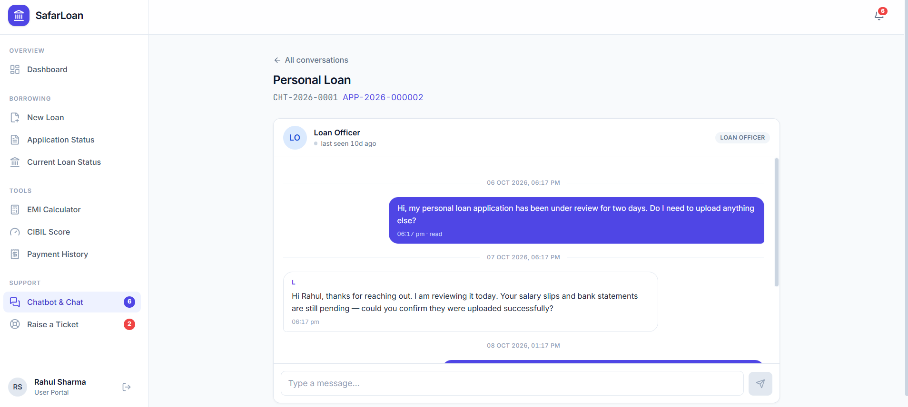
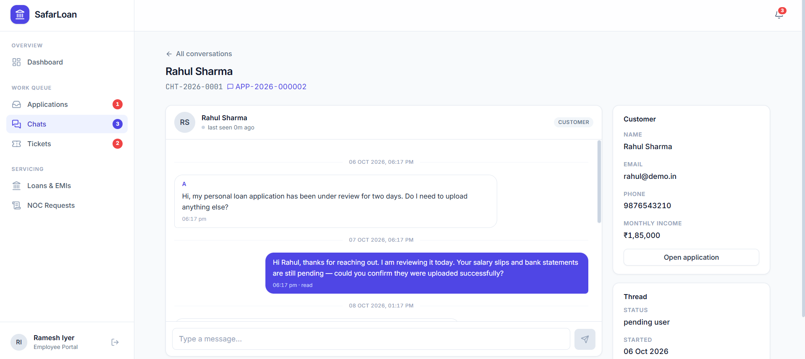

# 💳 SafarLoan — Full-Stack Loan Management Platform

---

[](https://nextjs.org)
[](https://react.dev)
[](https://typescriptlang.org)
[](https://tailwindcss.com)
[](https://supabase.com)
[](https://loanmanagement-omega.vercel.app/)

[](.github/workflows/ci.yml)
[](CONTRIBUTING.md)
[](tests/finance.test.ts)

---

**A three-portal digital lending platform built from `USER-OMA.txt` — applicants apply
and service loans, loan officers verify and sanction, admins manage users, products
and reporting.**

> **Live demo** — <https://loanmanagement-omega.vercel.app/>
>
> **Run it yourself** — clone, paste four Supabase keys, run `npm run db:setup`.
> Demo accounts are seeded; the password for all of them is `demo1234`.

## At a glance

| | |
|---|---|
| **Scale** | 30 routes across 3 role-gated portals · ~18,700 lines across 126 files |
| **Data model** | 25 tables · 20 enums · 39 RLS policies, enforced on every table |
| **Correctness** | 60 unit assertions over the finance and risk logic |
| **Verification** | 11 commands — SQL parsed by the real PostgreSQL parser, 61 seed invariants, 17 PostgREST embed checks, 30 routes rendered under live sessions |
| **CI** | 4 independently required status checks; database jobs gated behind secrets so a fork PR can never read `service_role` |
| **Domain** | Reducing-balance EMI · FOIR underwriting · two-tier sanctioning authority · DPDP-aligned PII handling |

### The parts worth reading

- **[`lib/finance/emi.ts`](lib/finance/emi.ts)** — amortisation where the final
  instalment absorbs accumulated rounding drift, so the principal column sums back to
  the original amount exactly. Covered by tests including the edge cases. An EMI that
  is off by a few paise is a support ticket forever.
- **[`supabase/migrations/0001_core_schema.sql`](supabase/migrations/0001_core_schema.sql)**
  — authorisation is enforced in Postgres, not trusted to application code. A leaked
  anon key exposes nothing, and deleting a user still cascades correctly.
- **[`scripts/`](scripts/)** — what makes the above checkable: the real PostgreSQL
  parser instead of a regex, assertions against live data instead of hopeful defaults,
  and a setup command that fails with the fix rather than a bare foreign-key error.
- **[`proxy.ts`](proxy.ts) + [`lib/portal.tsx`](lib/portal.tsx)** — role resolution
  funnels through one typed choke point, so a page cannot accidentally skip the check.

## Why this repo is shaped the way it is

Three portals, one database — so **Row Level Security is the security model**, not an
optional extra. Every money calculation is covered by a test suite, because an EMI
that is off by a few paise is a support ticket forever. And the two things teams
usually get wrong on Next.js + Supabase are documented here before they bite you:
`proxy.ts` instead of the deprecated `middleware.ts`, and a seed that has to run
*after* auth users, not before.

<p align="center">
  <b>User portal</b> — 9 destinations &nbsp;·&nbsp; <b>Officer portal</b> — underwriting
  &amp; sanction &nbsp;·&nbsp; <b>Admin portal</b> — users, products, audit
</p>

The portal gallery is further down — jump to [Screenshots](#screenshots).

---

## Table of contents

- [At a glance](#at-a-glance)
- [Quick start](#quick-start)
- [Demo accounts](#demo-accounts)
- [The three portals](#the-three-portals)
- [Interest maths](#interest-maths)
- [Realtime](#realtime)
- [Security](#security)
- [Third-party integrations](#third-party-integrations)
- [Resolved design questions](#resolved-design-questions)
- [Team workflow](#team-workflow)
- [Deploying](#deploying)
- [Project structure](#project-structure)
- [Scripts](#scripts)
- [What's built, what's next](#whats-built-whats-next)
- [Screenshots](#screenshots)

---

## Quick start

```bash
npm install
cp .env.example .env     # then paste your Supabase keys
```

`NEXT_PUBLIC_SUPABASE_URL` must be the **bare project URL**
(`https://<ref>.supabase.co`) with no `/rest/v1` suffix — the client library appends
that itself, and leaving it in produces `.../rest/v1/rest/v1/...`. The code
normalises it either way, but a clean value avoids surprises.

Then, for a **new** project, run the whole setup in one command:

```bash
npm run db:setup
```

That runs every step below in the only order that works, and stops at the first
failure with an explanation. The ordering is not cosmetic: `profiles` has a foreign
key to `auth.users`, so the demo accounts must exist **before** the seed runs. Doing
it the other way round gives you a bare
`violates foreign key constraint "profiles_id_fkey"` with nothing pointing at the
cause. The seed now preflights this and names the missing accounts.

<details>
<summary><b>The individual steps</b> (expand)</summary>

### 1 · Validate the SQL — no database needed

```bash
npm run db:check
```

Runs the real PostgreSQL parser (libpg_query via `@supabase/pg-parser`) plus
structural checks. Catches syntax errors, unbalanced dollar quoting, truncation,
unsafe apostrophes and `INSERT` column/value arity mismatches.

### 2 · Apply it — two options

**Option A — apply directly (recommended).** Add the connection string to `.env`:

```
DATABASE_URL=postgresql://postgres.<ref>:<password>@aws-0-<region>.pooler.supabase.com:6543/postgres
```

```bash
npm run db:migrate
```

This runs both files in order against the real database. It is the only way to catch
**type** errors (`column "mode" is of type payment_mode but expression is of type
text`), because those need a catalog to resolve against. You get the real message
with the real line number.

**Option B — SQL Editor.** Supabase Dashboard → SQL Editor → paste and run, in order:

| File | What it does |
|---|---|
| `supabase/migrations/0001_core_schema.sql` | Tables, enums, indexes, RLS policies, triggers, helpers |
| `supabase/migrations/0002_seed.sql` | Demo data: 9 products, 10 demo users, 12 applications, 5 loans, 3 chats, 3 tickets |

`0001_core_schema.sql` is **idempotent** — every table, index, enum, function, policy
and publication entry is created conditionally, so re-running it is a no-op rather
than `ERROR: type "user_role" already exists`.

`0002_seed.sql` **truncates** the application tables first, so it wipes any data you
have created and reloads the demo set. Run it whenever you want a clean slate.

### 3 · Create the auth users

```bash
npm run db:users
```

Supabase owns passwords, SQL seeds the profiles. All demo accounts use **`demo1234`**.

This must run **before** the seed (step 2), not after: the `handle_new_user` trigger
creates a `profiles` row for each signup, and the seed upserts on top of those rows.
`db:setup` sequences it correctly.

### 4 · Run the app

```bash
npm run dev
```

</details>

---

## Demo accounts

| Role | Email | What you'll see |
|---|---|---|
| User | `rahul@demo.in` | Active home loan, a personal loan under review, live chat |
| User | `priya@demo.in` | An application in **resubmission** state — the "fix your documents" flow |
| User | `sanjay@demo.in` | A loan with an **overdue** EMI and a bounced payment |
| User | `meera@demo.in` | Declined application, active 90-day block, issued NOC |
| Officer | `officer@demo.in` | Work queue, live underwriting scorecard, decision panel |
| Officer | `officer2@demo.in` | Different queue, ₹25L sanctioning limit |
| Manager | `manager@demo.in` | Manager-level authority |
| Admin | `admin@demo.in` | User management, product config, reports, audit log |

`kavya@demo.in` is deliberately **BLOCKED** — sign in to see the blocked-account path.

---

## The three portals

### Entry point

`app/login` → `proxy.ts` resolves the role → redirects to one of three portals.
The `proxy.ts` filename matters: Next.js 16 **deprecated `middleware.ts`**. Supabase's
own setup guide still tells you to create `middleware.ts`, so ignore that part of it.

### 1 · User portal (source doc line 8)

| Document requirement | Route |
|---|---|
| Dashboard (9 destinations) | `app/user/dashboard` |
| New Loan | `app/user/new-loan` + `[productId]` |
| Application Status | `app/user/applications` + `[id]` |
| Current Loan Status | `app/user/loans` + `[id]` |
| EMI Calculator | `app/user/emi-calculator` |
| CIBIL Score | `app/user/cibil` |
| Payment History | `app/user/payments` |
| Chatbot & Chat | `app/user/chat` + `[id]` |

### 2 · Loan categories (lines 10–23)

Nine products are seeded in `loan_products` with realistic Indian NBFC parameters:
**four secured** (home, vehicle, gold, loan-against-property) and **five unsecured**
(personal, education, business, credit-card, working-capital). Collateral types in use
are `PROPERTY`, `VEHICLE`, `GOLD` and `NONE`.

### 3 · Validation & verification (lines 26–102)

The multi-part checklist is **data-driven**. `document_requirements` holds one row per
document with its `part` (A/B/C/D), label, file type and whether it applies to a given
collateral type. The wizard renders itself from those rows, so adding a document is a
database insert, not a code change.

**Part A** is identical for every applicant (identity, residence, income, banking,
credit, liability). **Part B** filters by collateral — a gold loan sees purity and
grammage; a home loan sees title deed and encumbrance certificate.

### 4 · Applicant status (lines 107–131)

| State | Implementation |
|---|---|
| `PENDING` | `SUBMITTED` / `UNDER_REVIEW`, SLA date from `loan_products.sla_max_days`, assigned officer shown on hover |
| `APPROVED` | Creates the loan, generates the amortisation schedule, disburses, issues an account number |
| `FAILED` | `REJECTED` + a `cooling_periods` row blocking that **category** for 90 days |
| `RESUBMISSION` | Officer names the exact documents; only those unlock. Everything else stays locked |

### 5 · Current loan status (lines 138–170)

Last payment · Next payment · Overdue · Call support · NOC. Prepayment re-runs the
amortisation maths via `prepaymentImpact()` and flags the officer.

### 6 · Payment history (lines 174–179)

Receipts, bounce charges, overdue flags, transaction status, CSV/statement download.

### 7 · CIBIL score (lines 195–201)

`ID proof → validation → third-party API → our API → DB → dashboard`. Scores expire
after 30 days and must be re-pulled. See [integrations](#third-party-integrations).

---

## Resolved design questions

The source document left ten things open. Each was resolved with the industry-standard
practice, and the reasoning is recorded at the top of `0001_core_schema.sql`.

| # | Question | Decision |
|---|---|---|
| 1 | Admin portal scope | **User management, product config, reports, audit log** — all four |
| 2 | Employee tiers | Two-tier: **Officer** approves within a personal limit, **Manager** above it |
| 3 | Unsecured "Part C" asked for collateral | Copy-paste error. Replaced with **co-applicant/guarantor** verification, which is what unsecured lending actually uses |
| 4 | Loan configuration | `loan_products` table, fully admin-editable |
| 5 | Officer assignment | **Round-robin by category** — implemented as least-loaded, which self-corrects when someone is on leave |
| 6 | Processing time | Per-product `sla_min_days` / `sla_max_days` |
| 7 | Approval authority | Amount-based matrix: officer limit → manager → admin |
| 8 | Interest method | **Reducing balance.** Flat-rate interest is prohibited for retail loans under RBI norms |
| 9 | Grace period | **5 days** before an EMI is marked overdue |
| 10 | Bounce / late fee | `max(₹500 flat, 2% of overdue)`, configurable per product |

---

## Interest maths

Every number in the app comes from `lib/finance/emi.ts`, which mirrors the SQL
`calculate_emi()` function exactly.

```
EMI = P × r × (1+r)^n / ((1+r)^n − 1)      r = annualRate / 1200
```

`buildAmortization()` walks the balance month by month. The final instalment absorbs
accumulated rounding drift so the principal column sums back to the original amount
exactly — otherwise a ₹45L loan would be off by a few paise per row.

`prepaymentImpact()` models both options lenders offer: reduce tenure (EMI unchanged)
or reduce EMI (tenure unchanged), and reports the interest saved either way.

`lib/finance/risk.ts` implements **FOIR** — total obligations ÷ net monthly income —
plus income, amount, tenure, credit score and collateral-cover checks. Each rule returns
`PASS` / `WARN` / `FAIL` rather than a single opaque rejection, so officers see *which*
check failed and by how much.

---

## Realtime

Supabase Realtime is a managed WebSocket layer, so there's no socket server to run.

**Browser → Server is plain HTTP.** Server Components read Postgres during render;
Server Actions handle form posts. No WebSocket needed.

**Server → Browser is where Realtime earns its place** — five features from the source
document depend on push:

| Feature | Source line |
|---|---|
| Customer chats → notify officer in EMP portal | 111 |
| Officer replies → notify user in USER portal | 112 |
| Officer marks an EMI overdue → notify user | 155 |
| Chat Support, both directions | 110–112, 162 |
| Notification bell count | throughout |

Everything else — dashboards, the EMI calculator, application lists, payment history —
is a Server Component read and needs no subscription.

The pattern is consistent: **write to Postgres, then the Realtime subscription pushes
the new row.** Postgres is the source of truth; the WebSocket is only delivery. Tables
in the `supabase_realtime` publication: `notifications`, `applications`,
`chat_messages`, `emi_schedule`, `tickets`.

---

## Security

Every table has RLS enabled and policies that scope reads to the owner, the assigned
officer, or an admin.

| Key | Where | RLS |
|---|---|---|
| `NEXT_PUBLIC_SUPABASE_ANON_KEY` | Browser | Enforced |
| `SUPABASE_SERVICE_ROLE_KEY` | Server only, via `createAdminClient()` | Bypassed |

The service-role client exists for back-office work — listing all users, assigning
officers, cron jobs marking EMIs overdue. **Every call site must check the caller's role
first**, because that client trusts whoever holds it.

One DPDP Act 2023 note in the schema: `profiles.aadhaar_last4` stores only the last four
digits. Persisting full Aadhaar numbers is prohibited, and it is worth knowing that
before you build anything that does.

---

## Third-party integrations

All of these sit behind an adapter in `lib/services/`. Phase 1 ships mock
implementations returning realistic shapes, so business logic never changes when you
swap in the real call.

| Need | Production provider | Phase 1 |
|---|---|---|
| Credit bureau | Experian, Equifax, CRIF High Mark | Deterministic mock score in `lib/services/cibil.ts` |
| KYC / PAN / Aadhaar | IDfy, Signzy, Surepass, Setu | Form inputs only |
| Bank statements | Setu Account Aggregator, TrueBalance, Perfios | Manual upload rows |
| Payments | Razorpay, Cashfree, PayU | Mock gateway refs, `PAYMENT_PROVIDER=mock` |
| Email / SMS | Resend, MSG91, Interakt | `NOTIFICATION_PROVIDER=console` writes to the DB |
| Document storage | Cloudflare R2, Supabase Storage | `seed/…` placeholder paths |
| e-Bill / NOC PDF | `@react-pdf/renderer` | Bill rows generated, PDF pending |

Bureau and bank-statement APIs require signed NBFC agreements, so they can't be wired up
in a prototype. Payments, email and storage can be.

---

## Project structure

```
app/
  page.tsx                    # marketing landing
  login/ signup/              # auth (split-screen layout)
  user/                       # 7 dashboard destinations
  employee/                   # work queue, review screen, loans, NOC, chat, tickets
  admin/                      # users, products, staff, reports, audit

components/
  ui/                         # Button, Card, Badge, form controls, table, primitives
  layout/                     # portal shell, sidebar, notification bell
  applications/               # wizard, underwriting scorecard, decision panel
  chat/ loan/ cibil/          # feature components

lib/
  supabase/{client,server,admin}.ts    # three client variants
  actions/                    # Server Actions: auth, applications, chat, cibil
  services/cibil.ts           # credit bureau adapter (mockable)
  finance/emi.ts              # EMI + amortisation + prepayment
  finance/risk.ts             # FOIR, eligibility rules, approval authority
  queries/                    # read models per portal
  db/types.ts                 # domain types

supabase/migrations/          # 0001 schema · 0002 seed
proxy.ts                      # session refresh + role-based route guards
docs/screenshots/             # README images (hero, per-feature, portal grid)
```

---

## Scripts

```bash
npm run dev         # dev server
npm run build       # production build
npm run typecheck   # tsc --noEmit
npm run test        # finance test suite
npm run db:setup     # FIRST-TIME SETUP: auth users -> schema+seed -> verify (needs DATABASE_URL)
npm run db:check     # validate SQL (real parser, no DB needed)
npm run db:migrate   # apply SQL to the real database (needs DATABASE_URL)
npm run db:verify    # assert seed data integrity (needs DATABASE_URL)
npm run db:embeds    # validate every PostgREST embed (needs a database)
npm run db:relations # list FKs, check every embed hint resolves
npm run db:users     # create demo auth users
npm run db:users:reset  # reset all demo passwords
npm run db:diagnose  # test sign-in, list auth users and profiles
npm run db:types     # regenerate types from a live database
npm run smoke        # render every route with a real session (needs dev server)
```

`npm run build` runs `prebuild` first, which fails with an explicit list of any missing
Supabase environment variables. This is deliberate: `NEXT_PUBLIC_*` values are inlined
into the bundle at build time, so without the guard a missing variable ships a broken
deployment instead of a failed build.

### Automated checks

| Command | Needs a database | Runs on every PR |
|---|---|---|
| `npm run typecheck` | no | ✅ |
| `npm run test` | no | ✅ |
| `npm run db:check` | no | ✅ |
| `npm run build` | no | ✅ |
| `npm run db:migrate` | yes | 🔒 after merge / manual |
| `npm run db:verify` | yes | 🔒 |
| `npm run db:embeds` | yes | 🔒 |
| `npm run smoke` | yes | 🔒 |

CI (`.github/workflows/ci.yml`) runs the four offline checks per PR.
`.github/workflows/ci-live.yml` runs the database-backed ones after merge to `main`,
and on demand from the Actions tab.

---

## Team workflow

This is the `main` repository — treat `main` as protected and land changes only through
pull requests. Full detail in [CONTRIBUTING.md](CONTRIBUTING.md).

```bash
git checkout main && git pull
git checkout -b feat/short-description
# ... work, running the checks below locally ...
git commit -m "feat(scope): what changed"
git push -u origin feat/short-description
# open a PR against main
```

| Rule | Why |
|---|---|
| Never push directly to `main` | CI runs on every PR; direct pushes skip it |
| Two approvals, one from a non-author | Money maths and RLS need a second pair of eyes |
| `npm run smoke` before opening a PR | `next build` cannot catch session-scoped render errors |
| Add a migration rather than editing a shipped one | `0001` is idempotent, so re-running it is safe; already-applied migrations are not replayed by others' databases |

Repository secrets used by the live workflow:

```
DATABASE_URL               pooled connection string, port 6543
NEXT_PUBLIC_SUPABASE_URL   https://<ref>.supabase.co   (no /rest/v1)
NEXT_PUBLIC_SUPABASE_ANON_KEY
SUPABASE_SERVICE_ROLE_KEY
```

Add them under **Settings → Secrets and variables → Actions**. Point `DATABASE_URL` at a
**dedicated CI project**, not production — the seed truncates application tables.

---

## Deploying

Production deploys to Vercel. See **[DEPLOY.md](DEPLOY.md)** — environment variables,
the Supabase redirect-URL allow-list (the step that breaks sign-in when missed), and a
post-deploy checklist.

Short version: import the repo on Vercel, set the four variables above, add your Vercel
domain to Supabase's Site URL and Redirect URLs, then deploy. `npm run prebuild` fails
the build with an explicit list if any required variable is missing, so a misconfigured
deploy never silently ships.

---

## Screenshots

Six images, chosen because each one proves a claim the text above makes. The rest are
optional and listed at the [end of this section](#capturing-the-rest).

### The three portals

The whole product in three frames — borrowers, officers, admins, one database.

<table>
<tr>
<td width="33%" align="center"></td>
<td width="33%" align="center"></td>
<td width="33%" align="center"></td>
</tr>
<tr>
<td align="center"><b>User portal</b><br /><sub>9 destinations</sub></td>
<td align="center"><b>Officer portal</b><br /><sub>underwriting &amp; sanction</sub></td>
<td align="center"><b>Admin portal</b><br /><sub>users, products, audit</sub></td>
</tr>
</table>

### The multi-part wizard

Five parts — loan details, identity & income, collateral, consent, submit — driven by
`document_requirements`: one row per document with its part, label, file type and the
collateral types it applies to. Adding a document is a database insert, not a code
change. The live estimate on the right is the same EMI maths the loans run on.


### Realtime

Postgres is the source of truth; the WebSocket is only delivery. These two frames are
the same conversation seen from each portal — the one claim a static screenshot proves
least, which is why it is worth two images rather than one.

<table>
<tr>
<td width="50%" align="center"></td>
<td width="50%" align="center"></td>
</tr>
<tr>
<td align="center"><b>Borrower view</b></td>
<td align="center"><b>Officer view</b> — pushed without a refresh</td>
</tr>
</table>

### Realtime

### Capturing the rest

Live at **<https://loanmanagement-omega.vercel.app/>** — sign in as `rahul@demo.in`,
`officer@demo.in` or `admin@demo.in`, password `demo1234`. Paths below are relative to
the repository root, so a file dropped into `docs/screenshots/` with the right name is
already at the path it would be linked from.

| File | Route | Sign in as |
|---|---|---|
| `admin-dashboard.png` | `/admin/dashboard` | `admin@demo.in` |
| `admin-products.png` | `/admin/products` | `admin@demo.in` |
| `admin-staff.png` | `/admin/staff` | `admin@demo.in` |
| `admin-reports.png` | `/admin/reports` | `admin@demo.in` |
| `admin-audit-log.png` | `/admin/audit` | `admin@demo.in` |
| `officer-applications.png` | `/employee/applications` | `officer@demo.in` |
| `officer-scorecard.png` | `/employee/applications/20000000-0000-4000-8000-000000000002` | `officer@demo.in` |
| `officer-decision.png` | `/employee/applications/20000000-0000-4000-8000-000000000002` | `officer@demo.in` |
| `officer-loans.png` | `/employee/loans` | `officer@demo.in` |
| `officer-noc.png` | `/employee/noc` | `officer@demo.in` |
| `officer-tickets.png` | `/employee/tickets` | `officer@demo.in` |
| `officer-chats.png` | `/employee/chat` | `officer@demo.in` |
| `user-new-loan.png` | `/user/new-loan` | `rahul@demo.in` |
| `user-document-wizard.png` | `/user/new-loan/10000000-0000-4000-8000-000000000001` | `rahul@demo.in` |
| `user-applications.png` | `/user/applications` | `rahul@demo.in` |
| `user-application-detail.png` | `/user/applications/20000000-0000-4000-8000-000000000001` | `rahul@demo.in` |
| `user-resubmission.png` | `/user/applications/20000000-0000-4000-8000-000000000003` | `priya@demo.in` |
| `user-loan-detail.png` | `/user/loans/40000000-0000-4000-8000-000000000001` | `rahul@demo.in` |
| `user-emi-calculator.png` | `/user/emi-calculator` | `rahul@demo.in` |
| `user-cibil.png` | `/user/cibil` | `rahul@demo.in` |
| `user-payments.png` | `/user/payments` | `rahul@demo.in` |
| `user-tickets.png` | `/user/tickets` | `rahul@demo.in` |
| `landing.png` · `login.png` · `signup.png` | `/` · `/login` · `/signup` | — |

Two things that keep the repository small:

- **Export WebP, not PNG.** Typically 60–75% smaller for screenshots and GitHub renders
  it. A full-page capture drops from ~1 MB to ~250 KB with no visible difference.
- **Capture at 1×.** The README column is ~800px wide; a 2× image is paying four times
  for detail nobody sees.

There is no git-lfs configured, so every image committed stays in history permanently.
Renaming or replacing one later keeps both copies forever, which is why this section
shows six rather than two dozen.

## What's built, what's next

**Done:** full schema with RLS, seed data covering every state, auth and role routing,
all three portals, the data-driven multi-part wizard, live underwriting scorecard,
approve/reject/resubmit with schedule generation, loans with amortisation and overdue
tracking, CIBIL with expiry, live chat, tickets, NOC flow, EMI calculator.

**Not yet:** payment gateway integration, real bureau calls, PDF generation for e-Bill
and NOC, file upload to Supabase Storage, the chatbot (the source doc says
*"based on timing we create enhance one"*), and a scheduled job for overdue detection and
cooling-period expiry — that last one belongs in a Supabase Edge Function triggered by
`pg_cron`, which Supabase runs for you.

**Known gaps, stated plainly:** the read paths are exercised against a live database by
`npm run smoke`, but the write paths — approve, reject, resubmit, NOC issuance,
prepayment and payment actions — are not covered by automated tests yet. The third-party
integrations above are mocked behind an adapter rather than live. Treat those as the
next pieces of work, not as finished features.
